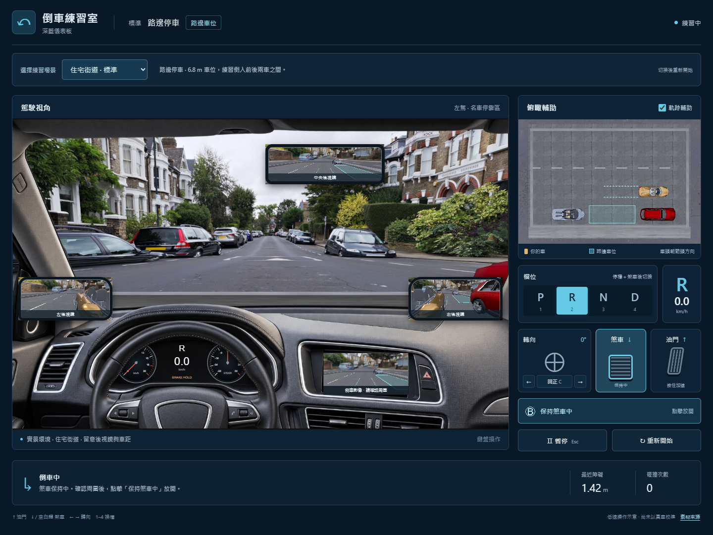

# 倒車練習室

深藍儀表板、駕駛視角、三面後視鏡與俯瞰輔助。正式程式位於 `app/`；原本的概念圖與畫面原型保留供比較。

## 選擇場景

畫面上方的「選擇練習場景」可切換三個實拍環境與練習配置：

| 場景 | 練習 | 目標 |
| --- | --- | --- |
| 商場停車場 | 入門垂直倒車入庫 | 03 號車位 |
| 住宅街道 | 標準路邊停車 | 6.8 × 2.6 m 車位 |
| 市區窄位 | 進階路邊停車 | 5.8 × 2.6 m 車位 |

路邊停車起點在前車旁，車位在右後方。利用 R 檔與轉向倒入，再以 D/R 修正；整車進入框內、車頭與路緣同向平行並停穩一秒才算完成。前後車與路緣都有碰撞判定。切換場景會清除本次操作和碰撞次數，回到 P 檔並保持煞車；「重新開始」保留目前場景。

座艙依使用者提供的車內照片製作透明照片式前景，搭配獨立旋轉的皮革方向盤、即時檔位／車速儀表與 R 檔倒車影像。玻璃、後視鏡與中控螢幕的開口顯示正在運作的 3D 場景。照片素材載入失敗時，會回到原本的立體座艙；鍵盤及右側操作面板仍可使用。這是固定駕駛視角的混合呈現，不支援在車內自由轉頭。

場景列的「駕駛座」可選左駕／右駕。請先煞停再切換；切換後保持煞車，保留位置、檔位、轉向與練習進度。方向盤、儀表、中控與駕駛視點同步換側，文字與倒車影像維持正常方向。左右駕不改變方向鍵、道路行進方向或車位位置。選擇會保留於重新開始、切換場景及下次開啟（瀏覽器允許儲存時）。

周圍停放 **Lamborghini Aventador、Rolls-Royce Cullinan、Ferrari 458 Italia**。車型的示意長寬與碰撞範圍一致，大型 SUV 會占用更多空間；兩種路邊停車都有完整無碰撞操作路徑的測試。未加入虛構車價或修理費。

## 開啟

線上版：[https://bboy800820.github.io/reverse_challenge/](https://bboy800820.github.io/reverse_challenge/)

雙擊本資料夾的 **launch.cmd**，瀏覽器會開啟 <http://127.0.0.1:5187>。若預覽服務已在執行，直接開啟該網址即可。關閉啟動程式的視窗會停止服務。

需要 Node.js 與 npm，建議 Node.js 24 LTS。此電腦已安裝依賴；搬到其他電腦時，第一次啟動會執行 `npm ci`，需要網路。不要直接用瀏覽器開 `app/index.html`，請透過啟動程式。

## 更新線上網站

推送程式到 `main` 後，GitHub Actions 會依序安裝依賴、執行測試、建置 `app/dist`，再部署到 GitHub Pages。可在儲存庫的 [Actions](https://github.com/bboy800820/reverse_challenge/actions/workflows/deploy-pages.yml) 查看進度或手動執行。

Pages 的發布來源須設為 **GitHub Actions**。`app/vite.config.ts` 的 `base` 設為 `/reverse_challenge/`，讓網站正確載入子目錄下的程式與樣式。若日後更換儲存庫名稱或自訂網域，需要一併調整此設定。網站只發佈 `app/dist`，概念圖、測試及開發文件保留在儲存庫。

部署設定參考 [Vite 官方說明](https://vite.dev/guide/static-deploy.html#github-pages)及 [GitHub Pages 工作流程說明](https://docs.github.com/en/pages/getting-started-with-github-pages/using-custom-workflows-with-github-pages)。

## 怎麼操作

點駕駛畫面右上角的「全螢幕練習」，可放大駕駛畫面，將原本控制移到下方，俯瞰改為可收合的小窗。進出時會暫停並保持煞車，位置和進度保留；點「繼續練習」再操作。全螢幕內按 Esc 或「退出全螢幕」返回原版介面；一般介面的 Esc 仍是暫停／繼續。窄螢幕預設收合俯瞰，可點「顯示俯瞰」展開。若瀏覽器不允許原生全螢幕，仍可使用頁面內放大模式。

1. 起始為 P 檔，並保持煞車。按 **2** 切入 R 檔。
2. 點「保持煞車中」放開煞車，車輛會慢慢蠕行。
3. 用 **← / →** 逐步轉向，鬆開會保持角度；**C** 是輔助回正。
4. **↑ 是油門**；**持續按住 ↓ 或空白鍵煞車**。踏板會顯示「踩下中」，車速歸零後顯示「已煞停」。放開煞車後 D/R 會恢復蠕行，要持續停止可點「保持煞車」。行進方向由 D/R 決定。
5. 停穩並踩住煞車，再用 **1 / 2 / 3 / 4** 切換 **P / R / N / D**。也可點擊檔位按鈕。
6. 利用後視鏡及俯瞰圖，將車完整停入目前場景的目標車位，車頭對齊並停穩一秒會顯示完成。

Esc 暫停／繼續。切到其他視窗時自動暫停；恢復後會保持煞車。碰撞會煞停並記次，踩住煞車換檔後可反向駛離。「重新開始」重設車輛與碰撞次數。

軌跡表示**保持目前前輪角度**時的預測路線，遇障礙即截斷；不是自動導航。距離是車身外框到周圍車輛／邊界的最短距離。P/N 檔不顯示預測線。

## 本版內容與限制

使用 Three.js 同一場景繪製五個視角，鏡面影像有水平反射。車外的商場、樹木、路燈、天空與遠處停車場改用實景拍攝的 360° 全景照片，並使用配對 HDR 提供反射與環境光，取代先前的簡化樹木和方塊建築。近處練習車位與車輛仍為互動 3D；座艙是照片式前景加動態元件。方向盤、儀表與前輪跟隨操作，煞車燈回應煞車。

遠景使用地面投影的照片，並非整個商場的三維重建；無法開近照片中的建築或遠方車輛，也不以照片裡的物件計算碰撞。所有可操作區域仍在俯瞰圖的練習場邊界內。

自車使用公開授權的 Ferrari 458 Italia 模型作為外觀示意，尺寸和材質經調整；概念圖中的 SUV、座艙和本版車模並非相同車款。車輛使用低速單軌模型與矩形車身碰撞；車身 1.8 × 4.5 m、軸距 2.7 m、前輪最大角度 32°、方向盤顯示比例 14:1、蠕行 0.32 m/s；這些數值尚未以特定實車校準。

場景與車模素材位於 `app/public/assets/realistic/`、`luxury/`；照片式座艙位於 `app/public/assets/cabin/`，每次只載入目前場景所需的環境與車款，隨 Pages 一起發布；執行時不呼叫第三方素材服務。自車車模已由 358,788 面減為 56,520 面，並重建平滑法線。載入期間可操作，部分素材失敗會提示並保留基礎場景。來源、修改說明及授權見 [素材署名頁](app/public/assets/credits.html) 與 [下載紀錄](app/public/assets/realistic/manifest.json)。在 Windows 重新下載可執行 `python scripts/fetch-visual-assets.py`，需要網路與已安裝的 npm 依賴；車模準備使用固定版本 glTF Transform 4.5.1，不加入網頁執行時依賴。

本版用來確認操作與視野，尚未驗證真車手感、鏡面視野及訓練成效。後續可換成特定車款的模型、轉向／加減速數據，再加入其他停車情境與回放。住宅和市區遠景是倫敦實拍，並非台灣特定路段。

## 專案位置

- `app/src/simulation.ts`：車輛、換檔、碰撞及停車判定。
- `app/src/scene.ts`：3D 場景、相機、鏡面與軌跡。
- `app/src/scenarios.ts`、`parking-layout.ts`：場景設定、起點、車位與一致的碰撞／視覺配置。
- `app/src/photo-cabin.ts`、`cockpit.ts`：照片式座艙與立體備援座艙。
- `app/src/fleet.ts`、`parked-vehicle.ts`、`detailed-vehicle.ts`：名車尺寸、鄰車呈現與自車外觀。
- `app/src/visual-assets.ts`：本機素材載入與資源生命週期。
- `app/src/input.ts`：鍵盤與滑鼠／觸控的共同輸入處理。
- `app/src/main.ts`、`style.css`：儀表板與操作提示。
- `assets/style-concepts/`：四張風格圖，採用 D。
- `assets/previews/`：實際程式的桌面與手機檢查截圖。
- `.agents/skills/`：本機安裝的 frontend-design、threejs-fundamentals、threejs-loaders；第三方技能不隨 Git 儲存庫上傳。
- `docs/superpowers/`：設計、實作順序及驗證紀錄。

## 驗證

在 `app/` 執行 `npm test` 和 `npm run build`。啟動預覽服務後，在專案根目錄依序執行 `python verify-app.py`、`python verify-brakes.py`、`python verify-render.py`、`python verify-visuals.py`（需要 Python、Playwright、Pillow 與 Edge）。檢查涵蓋車輛操作、一般及嵌入式鍵盤事件的煞車／釋放、高解析度螢幕的相機取景，以及模型、天空、路面材質各自失敗時的操作。`python scripts/preview-realistic.py` 會產生桌面與手機實際截圖。新增 `python scripts/verify-scenarios.py` 檢查三種場景、連續切換、鍵盤焦點、手機排版及街景載入失敗。`python scripts/verify-cabin-camera.py` 檢查捲動後車內倒車畫面持續更新。`python scripts/verify-cabin-clipping.py` 檢查 821–900px 的螢幕裁切。`python scripts/verify-photo-cabin.py` 檢查照片透明度、儀表結構、方向盤動畫、鏡面遮擋與素材失敗備援。`python scripts/preview-photo-cabin.py` 產生新版截圖。使用 `PARKING_URL` 環境變數指定測試網址。這些檢查不等於實車校準。

開發技能來源：[frontend-design](https://github.com/anthropics/skills/tree/main/skills/frontend-design)、[Three.js skills](https://github.com/CloudAI-X/threejs-skills)。技能非執行模擬器所必需。

渲染實作參考 [Three.js WebGLRenderer 官方文件](https://threejs.org/docs/pages/WebGLRenderer.html)。
