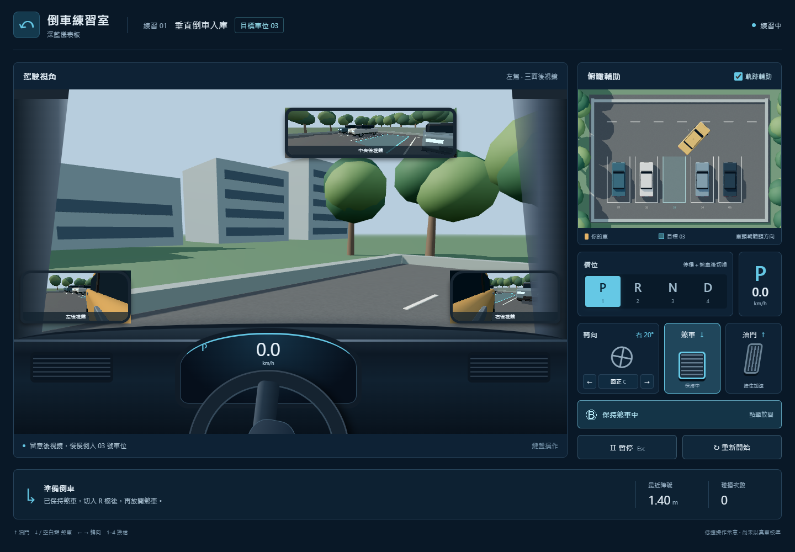

# 倒車練習室

深藍儀表板、駕駛視角、三面後視鏡與俯瞰輔助。正式程式位於 `app/`；原本的概念圖與畫面原型保留供比較。

## 開啟

雙擊本資料夾的 **launch.cmd**，瀏覽器會開啟 <http://127.0.0.1:5187>。若預覽服務已在執行，直接開啟該網址即可。關閉啟動程式的視窗會停止服務。

需要 Node.js 與 npm，建議 Node.js 24 LTS。此電腦已安裝依賴；搬到其他電腦時，第一次啟動會執行 `npm ci`，需要網路。不要直接用瀏覽器開 `app/index.html`，請透過啟動程式。

## 怎麼操作

1. 起始為 P 檔，並保持煞車。按 **2** 切入 R 檔。
2. 點「保持煞車中」放開煞車，車輛會慢慢蠕行。
3. 用 **← / →** 逐步轉向，鬆開會保持角度；**C** 是輔助回正。
4. **↑ 是油門**；**持續按住 ↓ 或空白鍵煞車**。踏板會顯示「踩下中」，車速歸零後顯示「已煞停」。放開煞車後 D/R 會恢復蠕行，要持續停止可點「保持煞車」。行進方向由 D/R 決定。
5. 停穩並踩住煞車，再用 **1 / 2 / 3 / 4** 切換 **P / R / N / D**。也可點擊檔位按鈕。
6. 利用後視鏡及俯瞰圖，將車完整停入 **03**，車頭對齊並停穩一秒會顯示完成。

Esc 暫停／繼續。切到其他視窗時自動暫停；恢復後會保持煞車。碰撞會煞停並記次，踩住煞車換檔後可反向駛離。「重新開始」重設車輛與碰撞次數。

軌跡表示**保持目前前輪角度**時的預測路線，遇障礙即截斷；不是自動導航。距離是車身外框到周圍車輛／邊界的最短距離。P/N 檔不顯示預測線。

## 本版內容與限制

使用 Three.js 同一場景繪製五個視角，鏡面影像有水平反射。車身與場景採程式建立的簡化模型，未達概念圖的寫實程度。車輛使用低速單軌模型與矩形車身碰撞；車身 1.8 × 4.5 m、軸距 2.7 m、前輪最大角度 32°、方向盤顯示比例 14:1、蠕行 0.32 m/s；這些數值尚未以特定實車校準。

本版用來確認操作與視野，尚未驗證真車手感、鏡面視野及訓練成效。後續可換成特定車款的模型、轉向／加減速數據，再加入其他停車情境與回放。

## 專案位置

- `app/src/simulation.ts`：車輛、換檔、碰撞及停車判定。
- `app/src/scene.ts`：3D 場景、相機、鏡面與軌跡。
- `app/src/input.ts`：鍵盤與滑鼠／觸控的共同輸入處理。
- `app/src/main.ts`、`style.css`：儀表板與操作提示。
- `assets/style-concepts/`：四張風格圖，採用 D。
- `assets/previews/`：實際程式的桌面與手機檢查截圖。
- `.agents/skills/`：本機安裝的 frontend-design、threejs-fundamentals、threejs-loaders；第三方技能不隨 Git 儲存庫上傳。
- `docs/superpowers/`：設計、實作順序及驗證紀錄。

## 驗證

在 `app/` 執行 `npm test` 和 `npm run build`。啟動預覽服務後，在專案根目錄執行 `python verify-app.py`、`python verify-brakes.py`、`python verify-render.py`（需要 Python、Playwright、Pillow 與 Edge）。檢查涵蓋車輛操作、一般及嵌入式鍵盤事件的煞車／釋放，以及一般與高解析度螢幕的相機取景。這些檢查不等於實車校準。

開發技能來源：[frontend-design](https://github.com/anthropics/skills/tree/main/skills/frontend-design)、[Three.js skills](https://github.com/CloudAI-X/threejs-skills)。技能非執行模擬器所必需。

渲染實作參考 [Three.js WebGLRenderer 官方文件](https://threejs.org/docs/pages/WebGLRenderer.html)。
